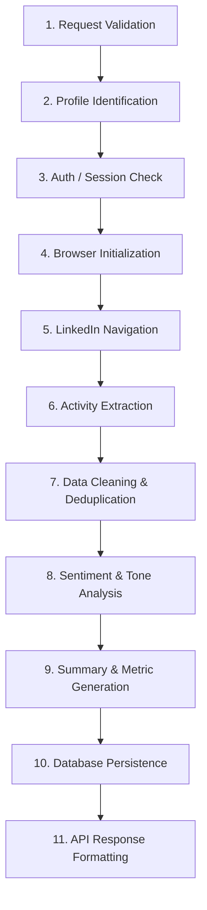
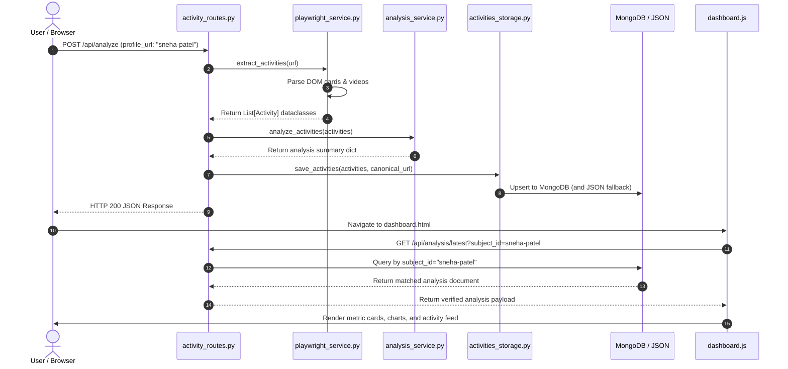

# LinkedIn Activity Analyzer — Master Learning & Technical Guide

Welcome to the **LinkedIn Activity Analyzer Master Learning Guide**. This comprehensive guide is structured specifically to help developers, engineers, and team leads thoroughly understand the complete system architecture, data flow, debugging methodologies, and code implementation of the application.

---

## Table of Contents
1. [Complete Project Architecture](#1-complete-project-architecture)
2. [Project File and Directory Guide](#2-project-file-and-directory-guide)
3. [Frontend-to-Backend Communication](#3-frontend-to-backend-communication)
4. [Flask Routes and API Endpoints](#4-flask-routes-and-api-endpoints)
5. [Playwright and LinkedIn Activity Extraction](#5-playwright-and-linkedin-activity-extraction)
6. [How Video Extraction Works](#6-how-video-extraction-works)
7. [MongoDB Integration and JSON Fallback](#7-mongodb-integration-and-json-fallback)
8. [How the Logging System Works](#8-how-the-logging-system-works)
9. [Where Log Files Are Stored](#9-where-log-files-are-stored)
10. [How to Open and Read Logs Using PowerShell](#10-how-to-open-and-read-logs-using-powershell)
11. [What Log Levels Mean: INFO, WARNING, ERROR, and DEBUG](#11-what-log-levels-mean-info-warning-error-and-debug)
12. [How Run IDs Trace Execution Requests](#12-how-run-ids-trace-execution-requests)
13. [How the Backend Processing Pipeline Works](#13-how-the-backend-processing-pipeline-works)
14. [How Data Moves From Extraction to Storage and Dashboard](#14-how-data-moves-from-extraction-to-storage-and-dashboard)
15. [How to Identify and Debug Common Errors](#15-how-to-identify-and-debug-common-errors)
16. [How to Run the Application and Test Suite](#16-how-to-run-the-application-and-test-suite)

---

## 1. Complete Project Architecture

The **LinkedIn Activity Analyzer** follows a decoupled, resilient **three-tier client-server architecture**:

```
+-----------------------------------------------------------------------+
|                            PRESENTATION LAYER                         |
|  Vanilla JavaScript (ES6+), HTML5, CSS3, Responsive Dashboard UI      |
|  (index.html, pages/dashboard.html, js/connections.js, dashboard.js)  |
+-----------------------------------+-----------------------------------+
                                    | REST API Calls (Fetch JSON)
                                    v
+-----------------------------------------------------------------------+
|                            APPLICATION LAYER                          |
|  Python 3 Flask Server (backend/app.py)                               |
|  +-------------------------+   +------------------------------------+ |
|  | Blueprint REST Routes   |   | Core Orchestration Services        | |
|  | (activity, connection,  |-->| (activity_service, analysis_svc,   | |
|  |  dashboard, auth)       |   |  sentiment_svc, pipeline_service)  | |
|  +-------------------------+   +-----------------+------------------+ |
|                                                  |                    |
|  +-------------------------------------+         v                    |
|  | Browser Automation Engine           |   +------------------------+ |
|  | Playwright (Chromium Headless)      |   | Internal Logging Engine| |
|  | (backend/linkedin/playwright_svc.py)|   | RotatingFileHandler    | |
|  +-------------------------------------+   | RunID Context Filter   | |
|                                            +------------------------+ |
+-----------------------------------+-----------------------------------+
                                    | Dual-Store Storage Adapters
                                    v
+-----------------------------------------------------------------------+
|                            PERSISTENCE LAYER                          |
|  PRIMARY: MongoDB Community Server (mongodb://localhost:27017)        |
|  Collections: saved_profiles, activities, latest_analysis,            |
|               profile_analysis_history, connections                   |
|                                                                       |
|  FALLBACK: Resilient Flat-File JSON Storage (backend/data/*.json)     |
+-----------------------------------------------------------------------+
```

### Core Architectural Principles:
1. **Resilient Persistence (Dual-Write Adapter Pattern)**: MongoDB is the primary datastore for fast querying, indexing, and scalability. If MongoDB is offline, storage adapters automatically degrade to local JSON files without interrupting user workflows or throwing 500 exceptions.
2. **Strict Profile-Level Data Isolation**: Analysis results, activity records, and cached metrics are partitioned by canonical profile URL slugs (e.g., `sneha-patel`). Cross-profile data contamination is strictly prevented at the validation, query, and storage layers.
3. **Internal Developer Observability**: Logging and multi-stage pipeline telemetry are strictly internal. Logs write directly to `logs/activity_analyzer.log` with automatic rotation and credential scrubbing. The end-user dashboard remains clean, focused, and free of technical clutter.
4. **Honest Media Taxonomy**: Media extraction avoids fabricating placeholder video links. Videos are categorized into verified playable streams, thumbnail-only previews with direct post links, embedded players, or authentication-restricted posts.

---

## 2. Project File and Directory Guide

```text
linkedin-activity-analyzer/
├── backend/
│   ├── app.py                         # Flask entry point, error handlers, and blueprint registrations
│   ├── data/                          # JSON fallback storage files
│   │   ├── activities.json            # Flat-file backup for activity records
│   │   ├── connections.json           # Flat-file backup for connections
│   │   ├── latest_analysis.json       # Flat-file backup for most recent analysis
│   │   ├── profile_analysis_history.json # Flat-file backup for historical runs
│   │   └── saved_target_profiles.json # Flat-file backup for profile metadata
│   ├── db/
│   │   └── mongo.py                   # MongoDB client, connection pooling, and index initialization
│   ├── linkedin/
│   │   ├── auth.py                    # LinkedIn OAuth 2.0 authorization and token exchange
│   │   ├── data_parser.py             # Parser for official LinkedIn archive CSVs (Connections.csv, Shares.csv)
│   │   └── playwright_service.py      # Playwright browser automation, DOM scraping, and video extractor
│   ├── models/
│   │   └── activity.py                # Typed dataclasses representing Activity and Media records
│   ├── routes/
│   │   ├── activity_routes.py         # Endpoints for activity analysis, URL validation, and history
│   │   ├── auth_routes.py             # OAuth login callbacks and session state
│   │   ├── connection_routes.py       # Connection management, self-profile derivation, and CSV import
│   │   └── dashboard_routes.py        # Dashboard summary hydration endpoints
│   ├── services/
│   │   ├── activities_storage.py      # Storage adapter for activities (MongoDB + JSON fallback)
│   │   ├── activity_service.py        # Orchestrator for Playwright scraping vs. stored data
│   │   ├── analysis_service.py        # Analytics computation: engagement, topic, sentiment scoring
│   │   ├── analysis_storage.py        # Storage adapter for analysis and history records
│   │   ├── connections_storage.py     # Storage adapter for connections records
│   │   ├── imported_activities_storage.py # Storage adapter for imported CSV activity records
│   │   ├── pipeline_service.py        # Internal 10-stage execution state tracker
│   │   ├── saved_profiles_storage.py  # Storage adapter for target profiles and photos
│   │   └── sentiment_service.py       # Rule-based NLP sentiment and tone scoring
│   └── utils/
│       ├── __init__.py
│       └── logger.py                  # Centralized rotating logger, RunID filter & credential scrubber
├── frontend/
│   ├── index.html                     # Landing page and profile URL entry form
│   ├── pages/
│   │   └── dashboard.html             # Clean analysis dashboard (metrics, charts, activity cards)
│   ├── js/
│   │   ├── activity.js                # Step 3 logic: date presets, filter checkboxes, analysis trigger
│   │   ├── connections.js             # Step 2 logic: connection listing, search, profile selection
│   │   └── dashboard.js               # Dashboard UI controller: renders metrics, feed, and video preview
│   └── css/
│       └── style.css                  # UI styling, responsive layout, cards, and badges
├── logs/
│   └── activity_analyzer.log          # Persistent, rotating internal log file
├── tests/
│   ├── test_profile_isolation.py      # Strict tests verifying cross-profile isolation
│   ├── test_workflow_playwright.py    # End-to-end Playwright workflow tests
│   ├── test_video_and_pipeline.py     # Tests for video extraction and internal pipeline states
│   └── ...                            # 178 unit and integration tests across the test suite
├── docs/
│   └── debugging-and-pipeline/        # Operational and debugging documentation
└── .env                               # Environment secrets (LinkedIn credentials, MongoDB URI)
```

---

## 3. Frontend-to-Backend Communication

Communication between the browser and backend uses standard asynchronous HTTP calls via the browser's native `fetch()` API.

### Common Flow:
1. **Initiating an Analysis**:
   - `frontend/js/activity.js` calls `POST /api/analyze` with a JSON payload:
     ```json
     {
       "profile_url": "https://www.linkedin.com/in/sneha-patel",
       "date_range": "30d",
       "activity_types": ["posts", "comments", "videos"]
     }
     ```
   - Before dispatching, `activity.js` validates that `profile_url` contains a valid slug and is not an incomplete root URL like `https://www.linkedin.com/in/`.

2. **Hydrating the Dashboard**:
   - When `pages/dashboard.html` loads, `frontend/js/dashboard.js` retrieves the selected profile from `sessionStorage` or query parameters.
   - It requests `GET /api/analysis/latest?subject_id=sneha-patel&profile_url=https://www.linkedin.com/in/sneha-patel`.
   - The backend validates that the latest record matches the requested identity. If verified, it returns HTTP 200 with the full analysis payload. If mismatched, it loads historical records for that specific slug or returns 404 with `has_data: false`.
   - `dashboard.js` then populates profile summary cards, metric statistics, sentiment distributions, and timeline activity cards.

---

## 4. Flask Routes and API Endpoints

| HTTP Method | Route URL | Purpose | Request Parameters / Payload | Response Schema |
| :--- | :--- | :--- | :--- | :--- |
| `POST` | `/api/analyze` | Initiates extraction and analysis for a target profile | `{"profile_url": str, "date_range": str, "activity_types": list}` | `{"status": "success", "analysis": {...}}` |
| `GET` | `/api/analysis/latest` | Retrieves analysis data with profile identity check | Query params: `subject_id`, `profile_url`, `subject_name` | `{"has_data": bool, "analysis": {...}}` |
| `GET` | `/api/connections` | Fetches saved connections and target profiles | Optional query params: `search`, `page`, `limit` | `{"connections": [...], "total": int}` |
| `POST` | `/api/connections/import` | Uploads and parses `Connections.csv` archive | `multipart/form-data` with `file` | `{"imported_count": int, "status": "success"}` |
| `GET` | `/api/dashboard/summary` | Aggregates high-level metrics for dashboard cards | None | `{"total_activities": int, "total_profiles": int, ...}` |
| `GET` | `/api/health` | Health check for MongoDB and backend services | None | `{"status": "healthy", "mongodb": "connected"}` |
| `GET` | `/api/pipeline/latest` | Internal diagnostic telemetry for execution runs | None | `{"run_id": str, "status": str, "stages": [...]}` |
| `GET` | `/api/logs` | Internal developer log query endpoint | Query params: `limit`, `search`, `level` | `{"lines": [...]}` |

---

## 5. Playwright and LinkedIn Activity Extraction

LinkedIn activity scraping is handled in `backend/linkedin/playwright_service.py` using Playwright's headless Chromium browser.

### Extraction Steps:
1. **Browser Initialization**:
   - Launches Chromium headless context with realistic user-agent headers and viewport dimensions.
   - Injects authenticated session cookies (specifically the `li_at` authentication cookie) from `.env`.
2. **Session Verification**:
   - Navigates to LinkedIn's feed or identity check URL.
   - Detects whether an authwall, login redirect, or security checkpoint (CAPTCHA) is encountered.
3. **Target Navigation**:
   - Navigates directly to the target member's activity stream:
     `https://www.linkedin.com/in/{slug}/recent-activity/all/`
4. **Feed Scrolling**:
   - Executes bounded, staggered scrolling down the feed to trigger lazy-loaded dynamic content while respecting rate limits.
5. **DOM Card Parsing**:
   - Identifies activity feed containers (`.feed-shared-update-v2`).
   - Extracts post text, relative timestamps (e.g. `"2d"`, `"1w"`), reaction counts, comment counts, author headline, and permalink URLs.
   - Invokes video extraction heuristics on each card.

---

## 6. How Video Extraction Works

Video posts on LinkedIn dynamically render in various DOM structures depending on device type, authentication state, and whether the post is native or embedded.

### Honest Status Taxonomy:
1. `ready_for_play`: Direct playable video URL extracted (e.g., MP4 CDN stream). Rendered inside an HTML5 `<video controls>` element.
2. `thumbnail_only`: A high-resolution poster thumbnail is available, but the video stream is either a session-bound blob or behind LinkedIn DRM. Rendered as a clickable preview card with a play badge linking directly to the LinkedIn post.
3. `embed_detected`: External third-party iframe (YouTube, Vimeo, Brightcove). Rendered inside a responsive `<iframe>`.
4. `requires_auth`: Video detected, but stream access requires active login credentials.
5. `not_video`: Standard text, image, or link post.

### Extraction Heuristics in `playwright_service.py`:
- **VideoJS Data Attributes**: LinkedIn often embeds video metadata inside a JSON string within the `data-sources` attribute of `.video-js`. The parser extracts and parses this JSON to retrieve raw `.mp4` URLs.
- **`<video src>` and `<source src>` Tags**: Direct HTML5 tags are scanned.
- **Blob URL Handling**: URLs starting with `blob:` (e.g., `blob:https://www.linkedin.com/...`) are scoped to the active browser memory session and cannot be replayed by external browsers. When a blob URL is encountered, the extractor discards the blob, retains the poster image, and assigns `video_status = "thumbnail_only"`.
- **Poster Thumbnails**: Extracted from `poster="..."` attributes or `.video-thumbnail` image elements to ensure the user always sees visual media.

---

## 7. MongoDB Integration and JSON Fallback

The application employs an **Adaptive Dual-Store Persistence Model** managed through storage adapter modules in `backend/services/`.

```
                    Storage Adapter Request (e.g. save_activity)
                                     |
                                     v
                       Try MongoDB (1.5s timeout)
                                   /    \
                                  /      \
                             Success    Timeout / Offline
                                /          \
                               v            v
                      Write to MongoDB    Log Warning & Fallback
                               \            /
                                v          v
                           Synchronous JSON Dual-Write
                       (backend/data/activities.json)
```

### Storage Adapters:
1. `activities_storage.py`: Manages the `activities` collection.
2. `analysis_storage.py`: Manages `latest_analysis` and `profile_analysis_history` collections.
3. `connections_storage.py`: Manages the `connections` collection.
4. `saved_profiles_storage.py`: Manages `saved_profiles` collection with photo protection rules.
5. `imported_activities_storage.py`: Manages user-uploaded archive data.

### Photo Protection Rule:
`saved_profiles_storage.py` enforces a strict safeguard: **Never overwrite an existing valid profile picture URL with `None` or an empty string.** If a subsequent scrape fails to extract a photo or returns `None`, the previously saved avatar URL is automatically preserved.

---

## 8. How the Logging System Works

The logging system is configured in `backend/utils/logger.py` and provides centralized, thread-safe, secure application monitoring.

### Key Features:
- **Automatic Log Rotation**: Uses Python's `logging.handlers.RotatingFileHandler`. When the active log file reaches **5 MB**, it is archived, and a fresh log file begins. Up to 5 archived backups are retained (`activity_analyzer.log.1` through `.5`), capping total disk usage at ~25 MB.
- **Run ID Context Injection**: A custom `RunIdContextFilter` reads thread-local storage. Every log line produced during a request lifecycle is stamped with that request's unique `RunID`.
- **Credential Redaction**: Before writing any record to disk, log messages pass through regex filters that scrub sensitive tokens, passwords, cookies (`li_at`), and API secrets, replacing them with `***REDACTED***`.
- **Strictly Internal**: Logs are designed for developers and system operators. The dashboard UI does not display technical logs or execution IDs to end users.

---

## 9. Where Log Files Are Stored

Log files are stored in the project's root `logs/` directory:

```text
linkedin-activity-analyzer/
└── logs/
    ├── activity_analyzer.log        # Active log file (appended in real time)
    ├── activity_analyzer.log.1      # Most recent rotated backup
    ├── activity_analyzer.log.2      # Backup 2
    ├── activity_analyzer.log.3      # Backup 3
    ├── activity_analyzer.log.4      # Backup 4
    └── activity_analyzer.log.5      # Oldest retained backup
```

---

## 10. How to Open and Read Logs Using PowerShell

PowerShell commands for real-time monitoring and log querying:

### 1. Real-Time Log Tailing (Follow Live Output)
```powershell
Get-Content -Path "logs/activity_analyzer.log" -Wait -Tail 40
```

### 2. Search for Errors and Exceptions
```powershell
Select-String -Path "logs/activity_analyzer.log" -Pattern "ERROR"
```

### 3. Trace All Events for a Specific Run ID
```powershell
Select-String -Path "logs/activity_analyzer.log" -Pattern "run_20261103_231800"
```

### 4. Search for Video Extraction Activity
```powershell
Select-String -Path "logs/activity_analyzer.log" -Pattern "video" -CaseSensitive:$false
```

### 5. View the Last 100 Lines of Logs
```powershell
Get-Content -Path "logs/activity_analyzer.log" -Tail 100
```

---

## 11. What Log Levels Mean: INFO, WARNING, ERROR, and DEBUG

| Level | Severity | When It Is Used in This Project | Example Message |
| :--- | :--- | :--- | :--- |
| `DEBUG` | Low | Granular diagnostic information, DOM element dumps, regex matches, raw queries | `[DEBUG] Extracted video source: https://dms.licdn.com/...` |
| `INFO` | Normal | Standard operational events, request intake, stage completions, HTTP 200 | `[INFO] POST /api/analyze -> 200 (145.2ms)` |
| `WARNING` | Moderate | Recoverable anomalies, fallback mechanisms activated, deprecation notices | `[WARNING] MongoDB ping delayed (1500ms); falling back to JSON storage` |
| `ERROR` | High | Operation failures, rate limits, network timeouts, invalid inputs | `[ERROR] LinkedIn authwall encountered for profile: payal-pal` |
| `CRITICAL` | Severe | Fatal system problems preventing the backend from functioning | `[CRITICAL] Unable to initialize storage directories` |

---

## 12. How Run IDs Trace Execution Requests

In a web application handling multiple user requests, log entries from concurrent users can become interleaved. A **Run ID** solves this problem by stamping every log record with a unique identifier.

### How It Works:
1. When a request hits `/api/analyze`, `activity_routes.py` creates a unique Run ID using timestamp and UUID:
   `run_20261103_231800_eda60a`
2. This Run ID is saved into Python's `threading.local` state.
3. Every logger call within that thread automatically inherits the Run ID via `RunIdContextFilter`.
4. The output format stamps the ID:
   ```text
   [2026-11-03 23:18:00] [INFO] [activity_routes] [RunID: run_20261103_231800_eda60a] Analyzing profile: sneha-patel
   [2026-11-03 23:18:02] [INFO] [playwright_service] [RunID: run_20261103_231800_eda60a] Page loaded successfully
   [2026-11-03 23:18:05] [INFO] [analysis_storage] [RunID: run_20261103_231800_eda60a] Saved 12 activities to MongoDB
   ```
5. Developers can isolate the complete lifecycle of that single request using PowerShell:
   ```powershell
   Select-String -Path "logs/activity_analyzer.log" -Pattern "run_20261103_231800_eda60a"
   ```

---

## 13. How the Backend Processing Pipeline Works

The backend executes an **11-step logical processing workflow**:



### Logical Steps Explained:
1. **Request Validation**: Rejects invalid or root URLs (e.g. `https://www.linkedin.com/in/`) with HTTP 400.
2. **Profile Identification**: Extracts the canonical slug (`sneha-patel`) from the URL.
3. **Auth / Session Check**: Verifies LinkedIn session tokens and cookie validity.
4. **Browser Initialization**: Launches Playwright headless Chromium with custom headers.
5. **LinkedIn Navigation**: Loads the target member's `/recent-activity/all/` URL.
6. **Activity Extraction**: Parses activity update cards, post text, dates, and media.
7. **Data Cleaning & Deduplication**: Cleans text bodies and eliminates duplicate posts.
8. **Sentiment & Tone Analysis**: Calculates positive, neutral, negative, and tone distributions.
9. **Summary & Metric Generation**: Aggregates total posts, engagement rates, reactions, and comments.
10. **Database Persistence**: Writes records to MongoDB with synchronized JSON fallback.
11. **API Response Formatting**: Constructs a clean JSON response payload for the frontend.

*(Note: Internal execution telemetry in `pipeline_service.py` monitors these stages across 10 observable checkpoints for diagnostics).*

---

## 14. How Data Moves From Extraction to Storage and Dashboard



---

## 15. How to Identify and Debug Common Errors

### Error 1: Profile Data Mismatch (Selecting Sneha Patel Shows Pragyanand Sahoo)
- **Symptom**: Dashboard displays activities belonging to a different user after selecting a profile.
- **Root Cause**:
  1. Frontend defaulted `profile_url` to `https://www.linkedin.com/in/` without a slug.
  2. Storage queried MongoDB using unanchored regex `re.compile(re.escape(url))` which matched every `/in/` URL.
  3. `analysis_storage.py` fallback regex stripped slashes, producing `"httpswwwlinkedincomin"`.
  4. Frontend called `GET /api/analysis/latest` without passing identity parameters.
- **Solution Applied**:
  - Validated URLs on both frontend and backend to reject incomplete root URLs.
  - Extracted canonical slug (`extract_slug()`) and bounded regex queries to `/in/{slug}(?:/|\\?|$)`.
  - Added identity verification in `GET /api/analysis/latest`.

### Error 2: "Activity could not be retrieved from LinkedIn. LinkedIn authwall encountered."
- **Symptom**: Playwright returns authwall error; 0 activities extracted.
- **Root Cause**: The LinkedIn session cookie (`li_at` in `.env`) has expired or been invalidated by LinkedIn security.
- **Solution**:
  1. Log into LinkedIn in an external browser.
  2. Inspect Cookies under Developer Tools (`F12` -> Application -> Cookies -> `https://www.linkedin.com`).
  3. Copy the value of the `li_at` cookie.
  4. Update `LINKEDIN_COOKIE` in your `.env` file.
  5. Restart the Flask backend.

### Error 3: MongoDB Offline or Connection Refused (`[WinError 10013]`)
- **Symptom**: Logs display `ServerSelectionTimeoutError` or connection refused on `localhost:27017`.
- **Behavior**: The application automatically engages JSON dual-write fallback.
- **Solution**: To restore primary database functionality, start MongoDB:
  ```powershell
  net start MongoDB
  # Or run mongod directly:
  mongod --dbpath "C:\data\db"
  ```

### Error 4: Video Shows Black Box or Won't Play
- **Symptom**: A video card shows an unplayable box.
- **Root Cause**: The video stream was a browser session-scoped `blob:https://...` URL.
- **Solution**: The system automatically detects blob URLs, falls back to `thumbnail_only`, and provides an "Open on LinkedIn" button so the user can view the native video directly on LinkedIn.

---

## 16. How to Run the Application and Test Suite

### 1. Activating the Virtual Environment
```powershell
# From project directory:
d:\likedin_analysis\.venv\Scripts\Activate.ps1
```

### 2. Starting the Application
```powershell
cd d:\likedin_analysis\linkedin-activity-analyzer
python backend/app.py
```
Open your browser at `http://127.0.0.1:5000`.

### 3. Running the Test Suite
The test suite automatically routes database operations to the isolated `linkedin_activity_analyzer_test` database, protecting production data.

```powershell
# Run the complete test suite (all 178 tests):
python -m unittest discover tests

# Run dedicated profile isolation tests:
python -m unittest tests.test_profile_isolation

# Run workflow Playwright tests:
python -m unittest tests.test_workflow_playwright

# Run video extraction and internal pipeline tests:
python -m unittest tests.test_video_and_pipeline
```

