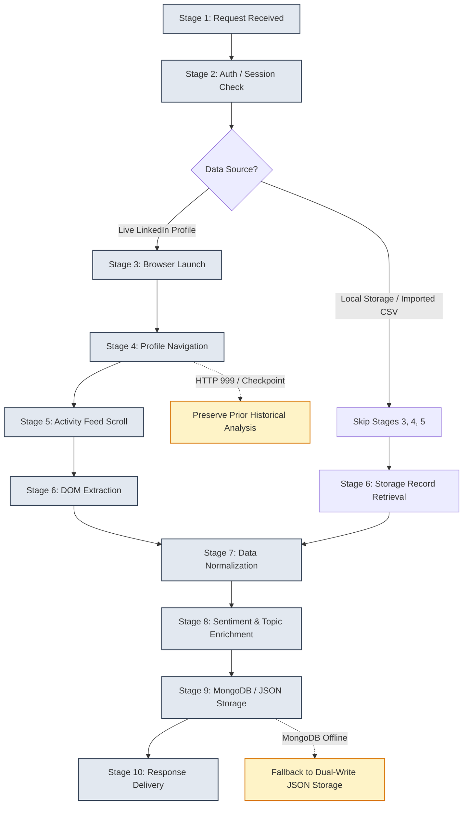

# LinkedIn Activity Analyzer – Pipeline Architecture & Execution Stages

> **Architectural Note**: Pipeline telemetry and tracking operate **strictly internally** for developers, background workers, and system operators. Technical pipeline progress, internal Run IDs, and raw execution stages are intentionally hidden from end users to maintain a clean, distraction-free dashboard.

## 1. Architectural Workflow (11 Logical Steps)

The backend processing workflow follows **11 modular steps**:
1. **Request validation**: Validates request parameters and explicitly rejects incomplete root URLs (`https://www.linkedin.com/in/`).
2. **Profile identification**: Extracts canonical user slugs (`sneha-patel`) to prevent cross-profile data leakage.
3. **Authentication/session validation**: Checks LinkedIn session tokens and cookie validity.
4. **Browser initialization**: Configures and launches Playwright headless Chromium.
5. **LinkedIn navigation**: Navigates to the target member's `/recent-activity/all/` feed.
6. **Activity extraction**: Scrapes activity cards, post text, relative dates, and media.
7. **Data cleaning and deduplication**: Cleans text bodies and deduplicates activities by post permalink.
8. **Sentiment and tone analysis**: NLP lexical analysis scoring sentiment (positive, neutral, negative) and tone.
9. **Summary and metric generation**: Computes aggregate metrics, engagement rates, and activity distribution.
10. **Database persistence**: Persists documents to MongoDB primary datastore with synchronized JSON fallback.
11. **API response formatting**: Formats and delivers clean, typed JSON responses to the client.

For runtime monitoring, these steps are grouped into **10 observable telemetry stages** tracked by `pipeline_service.py`.

## 2. Telemetry Workflow Diagram



---

## 2. Comprehensive Stage-by-Stage Specification

### Stage 1: Request Received (`id: 1`)
- **Name**: Request Received
- **Purpose**: Validate incoming URL or subject payload, initialize thread-local Run ID context, and register new pipeline tracking instance.
- **Inputs**: HTTP request body or query parameters (`url`, `subject_id`, `startDate`, `endDate`, `activities`).
- **Outputs**: Verified canonical URL slug, initial tracking object with 10 pending stages.
- **Failure Modes**: Missing URL, invalid domain format (e.g. non-LinkedIn host).
- **Fallback Behavior**: Returns HTTP 400 with actionable error prompt; marks Stage 1 as `failed`.
- **Associated Logs**: `[Stage 1: Request Received] Started - Validating input URL`, `Pipeline run started: <run_id>`.

### Stage 2: Auth / Session Check (`id: 2`)
- **Name**: Auth / Session Check
- **Purpose**: Verify LinkedIn session status, cookies, and OAuth access tokens.
- **Inputs**: Flask session cookies (`li_at`, session tokens), environment configuration.
- **Outputs**: Authentication state boolean (`authenticated: True/False`), account name, and profile photo.
- **Failure Modes**: Expired `li_at` cookie, missing credentials.
- **Fallback Behavior**: In development/testing, falls back to authorized testing profile ("Aniket Pal"); in unauthenticated mode, allows CSV import workflow without OAuth.
- **Associated Logs**: `[Stage 2: Auth / Session Check] Checking active session`, `Authenticated session confirmed: YES/NO`.

### Stage 3: Browser Launch (`id: 3`)
- **Name**: Browser Launch
- **Purpose**: Launch Playwright headless Chromium instance and configure isolated browser context with anti-detection headers.
- **Inputs**: Chromium binary path, browser launch arguments (`headless=True`, viewport dimensions).
- **Outputs**: Live Playwright `BrowserContext` and `Page` objects.
- **Failure Modes**: Chromium binary missing, sandbox socket isolation error (`[WinError 10013]`).
- **Fallback Behavior**: Skips to cached/historical analysis if available; raises clear automation exception if live retrieval mandatory.
- **Associated Logs**: `[Stage 3: Browser Launch] Launching headless browser`, `Playwright browser launched in Xms`.

### Stage 4: Profile Navigation (`id: 4`)
- **Name**: Profile Navigation
- **Purpose**: Navigate to the target profile's recent activity feed URL (`/recent-activity/all/`).
- **Inputs**: Target profile canonical URL.
- **Outputs**: Loaded DOM of LinkedIn activity feed page.
- **Failure Modes**: HTTP 999 Request Denied, LinkedIn Security Checkpoint, 404 Profile Not Found.
- **Fallback Behavior**: Preserves historical analysis from MongoDB or JSON history file so the dashboard displays preserved metrics instead of zeroing out.
- **Associated Logs**: `[Stage 4: Profile Navigation] Navigating to target profile`, `HTTP 999 / Checkpoint detected`.

### Stage 5: Activity Feed Scroll (`id: 5`)
- **Name**: Activity Feed Scroll
- **Purpose**: Incrementally scroll the page to trigger lazy loading of post cards within bounds (`max_scrolls`).
- **Inputs**: `max_scrolls` (default: 5-10), scroll step intervals.
- **Outputs**: Expanded DOM containing rendered post cards.
- **Failure Modes**: Infinite scroll blocked by auth modal or end of public feed.
- **Fallback Behavior**: Stops scrolling immediately when ceiling reached or modal detected, parsing whatever cards loaded.
- **Associated Logs**: `[Stage 5: Activity Feed Scroll] Feed scroll iteration X of Y`.

### Stage 6: DOM Extraction (`id: 6`)
- **Name**: DOM Extraction
- **Purpose**: Extract raw post content, author details, relative timestamps, and video media elements (`_extract_video_info`).
- **Inputs**: Post card DOM containers (`div.feed-shared-update-v2`).
- **Outputs**: Raw activity dictionaries with `video_url`, `video_thumbnail`, `video_status`.
- **Failure Modes**: Changed LinkedIn CSS class names, missing element attributes.
- **Fallback Behavior**: Graceful fallback to text-only extraction with `thumbnail_only` or `not_video` classification.
- **Associated Logs**: `[Stage 6: DOM Extraction] Found X post elements`, `Video info for post: status=ready_for_play`.

### Stage 7: Data Normalization (`id: 7`)
- **Name**: Data Normalization
- **Purpose**: Convert relative timestamps ("3d", "2w", "1mo") to ISO dates (`YYYY-MM-DD`), deduplicate posts by ID/URL, and instantiate typed `Activity` models.
- **Inputs**: Raw activity dictionaries, date filter criteria (`startDate`, `endDate`).
- **Outputs**: Normalized, deduplicated `List[Activity]` matching the requested criteria.
- **Failure Modes**: Unparseable date strings.
- **Fallback Behavior**: Assigns current date or marks as approximate rather than discarding the activity.
- **Associated Logs**: `[Stage 7: Data Normalization] Normalized X items, Y excluded by date filter`.

### Stage 8: Sentiment & Topic Enrichment (`id: 8`)
- **Name**: Sentiment & Topic Enrichment
- **Purpose**: Analyze text sentiment (Positive, Neutral, Negative), tone classification, and engagement metrics calculation.
- **Inputs**: Activity text content, engagement counts (likes, comments, shares).
- **Outputs**: Computed `sentiment_summary`, per-post sentiment scores and tones.
- **Failure Modes**: NLP service timeout or empty post text.
- **Fallback Behavior**: Assigns default `Neutral` or `Not available` without failing the pipeline.
- **Associated Logs**: `[Stage 8: Sentiment & Topic Enrichment] Processed sentiment for X activities`.

### Stage 9: MongoDB / JSON Storage (`id: 9`)
- **Name**: MongoDB / JSON Storage
- **Purpose**: Persist analysis results, activities, and saved target profile to MongoDB Local with synchronous JSON fallback.
- **Inputs**: Combined analysis dictionary, activity list.
- **Outputs**: Persisted documents in `activities`, `latest_analysis`, `profile_analysis_history`, and `saved_profiles`.
- **Failure Modes**: MongoDB service offline or connection pool timeout.
- **Fallback Behavior**: Transparently writes to JSON files (`latest_analysis.json`, `activities.json`) without interrupting the user request.
- **Associated Logs**: `[Stage 9: MongoDB / JSON Storage] Analysis persisted to MongoDB / JSON fallback`.

### Stage 10: Response Delivery (`id: 10`)
- **Name**: Response Delivery
- **Purpose**: Inject `run_id`, total execution metrics, and package HTTP 200 response payload for client dashboard rendering.
- **Inputs**: Complete analysis dictionary, pipeline run state.
- **Outputs**: Final JSON response delivered to frontend.
- **Failure Modes**: Client socket disconnected.
- **Fallback Behavior**: Logs pipeline completion; data remains safely persisted for subsequent retrieval.
- **Associated Logs**: `Pipeline run <run_id> finished with status: completed (duration: Xms)`.

---

## 3. Pipeline State Management

The pipeline manager (`backend/services/pipeline_service.py`) maintains an in-memory registry of recent runs protected by a `threading.Lock`:
- Stores up to **50 recent pipeline executions** (`MAX_KEPT_RUNS = 50`).
- Generates collision-resistant, timestamped IDs: `run_YYYYMMDD_HHMMSS_<6hex>`.
- Supports transitions: `pending` → `running` → `completed` | `skipped` | `failed`.

---

## 4. REST Monitoring Endpoints

### 1. `GET /api/pipeline/latest`
Returns the status, stage-by-stage timings, and metrics of the most recent pipeline run.

**Response Structure:**
```json
{
  "run_id": "run_20261103_214715_eda60a",
  "target_profile": "https://www.linkedin.com/in/payal-pal",
  "status": "completed",
  "start_time": "2026-11-03T21:47:15.100234",
  "end_time": "2026-11-03T21:47:15.162834",
  "total_duration_ms": 62.6,
  "summary": {
    "cards_found": 15,
    "videos_detected": 3,
    "activities_stored": 15,
    "error": null
  },
  "stages": [
    {
      "id": 1,
      "name": "Request Received",
      "description": "Validation and intake of profile request",
      "status": "completed",
      "duration_ms": 0.4,
      "items_count": 1,
      "details": "Validating input URL",
      "error": null
    }
  ]
}
```

### 2. `GET /api/pipeline/<run_id>`
Retrieves the execution state of a specific pipeline run by ID. Returns HTTP 404 if the run ID is not found.

### 3. `GET /api/pipeline/runs`
Returns an ordered summary list of all tracked pipeline runs.

---

## 5. Guide: Safely Adding a New Pipeline Stage

To add an 11th stage (e.g., "Export Generation"):
1. In `backend/services/pipeline_service.py`, append the definition to `STAGE_DEFINITIONS`:
   ```python
   {"id": 11, "name": "Export Generation", "description": "Generating PDF/CSV summary report"}
   ```
2. In `backend/routes/activity_routes.py`, wrap your logic with:
   ```python
   start_stage(run_id, 11, "Rendering export artifact")
   # ... perform work ...
   complete_stage(run_id, 11, items_count=1)
   ```
3. The frontend `dashboard.html` and `dashboard.js` automatically render the new stage in the 10-stage stepper without any manual UI changes.

