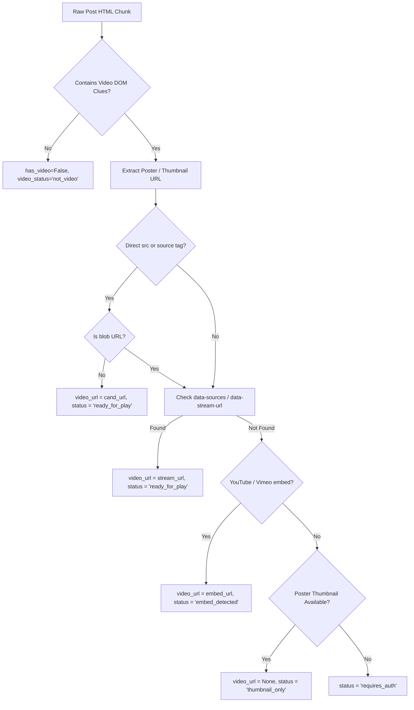
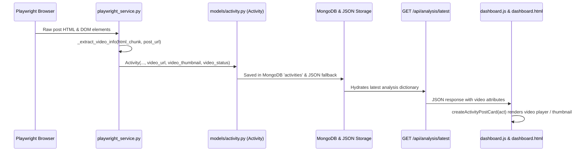

# LinkedIn Activity Analyzer – Video Debugging Guide

## 1. Executive Summary & Root Cause Analysis

Prior to this update, LinkedIn video posts either rendered as generic text cards, failed to display video players/thumbnails, or misclassified video content. The root causes were identified through a complete architectural audit:

1. **Selector and Classification Gaps**:
   - `playwright_service.py` checked for `<video>` tag presence solely to set `action_type = "video"`.
   - It did **not** extract direct `<video src="...">`, nested `<source src="...">`, VideoJS `data-sources` JSON payloads, or `data-stream-url` streaming manifests.
   - It failed to extract video poster thumbnails (`<video poster="...">` or `.video-thumbnail img`), leaving the UI with no visual preview when stream URLs were auth-gated.

2. **Data Model Omissions**:
   - The backend `Activity` dataclass (`models/activity.py`) completely lacked explicit video attributes (`video_url`, `video_thumbnail`, `video_status`).
   - Consequently, serialization in `analysis_service.py` dropped all video attributes when packaging activities for the frontend, MongoDB, and JSON storage.

3. **Frontend Rendering Shortcomings**:
   - `dashboard.js` only checked `mediaUrl.match(/\.(jpg|jpeg|png...)/)` and rendered a plain `` tag.
   - Video posts had no `<video controls>` tag, no embed `<iframe>` support for external videos (e.g., YouTube/Vimeo), and no visual badge or thumbnail overlay indicating video playback status.

---

## 2. How LinkedIn Renders Videos in the DOM

LinkedIn delivers videos using dynamic, client-side rendering with several DOM structures:

### A. Direct or Native Video Tags
```html
<div class="feed-shared-update-v2">
  <div class="feedshare-video">
    <video class="video-js vjs-tech" 
           src="https://dms.licdn.com/playlist/vid1/mp4_720p.mp4" 
           poster="https://media.licdn.com/dms/image/v2/.../poster.jpg" 
           controls>
      <source src="https://dms.licdn.com/playlist/vid1/mp4_720p.mp4" type="video/mp4">
    </video>
  </div>
</div>
```

### B. VideoJS with Embedded JSON Data Sources
LinkedIn frequently attaches high- and low-bitrate streams inside an HTML-encoded `data-sources` attribute:
```html
<video class="video-js"
       data-sources='[{"src":"https://dms.licdn.com/playlist/v1.mp4","type":"video/mp4"}]'
       poster="https://media.licdn.com/poster.jpg">
</video>
```

### C. Adaptive Streaming Manifests (`data-stream-url`)
For long-form or adaptive streaming, LinkedIn provides HLS or MPEG-DASH manifest endpoints:
```html
<video data-stream-url="https://dms.licdn.com/playlist/manifest.mpd" 
       poster="https://media.licdn.com/poster.jpg">
</video>
```

### D. Blob URLs & Auth-Gated Players
When the video player initializes in a live browser, JavaScript may create a temporary `blob:https://www.linkedin.com/...` URL. **Blob URLs cannot be replayed outside the active browser memory context**. In such cases, the system extracts the stable `poster` image and marks status as `thumbnail_only` or `requires_auth`.

### E. Embedded Third-Party Videos (YouTube, Vimeo)
Posts linking to external video platforms contain iframe embeds:
```html
<div class="feed-shared-external-video">
  <iframe src="https://www.youtube.com/embed/dQw4w9WgXcQ"></iframe>
</div>
```

---

## 3. Playwright Video Extraction Architecture

The extraction logic lives in `backend/linkedin/playwright_service.py` inside `_extract_video_info()`:



### Video Status Taxonomy
To guarantee honesty and never fabricate fake media URLs:
1. `ready_for_play`: Direct HTTPS `.mp4` or streaming URL extracted; playable in dashboard HTML5 `<video>`.
2. `thumbnail_only`: Poster thumbnail found; direct video stream requires LinkedIn authentication or is blob-gated.
3. `embed_detected`: Third-party embed (e.g. YouTube); playable in dashboard `<iframe>`.
4. `requires_auth`: Post confirmed as video, but stream and thumbnail are gated behind user credentials.
5. `not_video`: Post is standard text, image, document, or poll.

---

## 4. End-to-End Data Journey: Scraper to UI



---

## 5. Step-by-Step Video Debugging Workflow

When videos fail to appear or play in the dashboard, follow this exact checklist:

### Step 1: Check Pipeline Stage 6 DOM Extraction
Inspect `logs/activity_analyzer.log` for Stage 6 entries:
```bash
grep -E "\[Stage 6\]|Video info" logs/activity_analyzer.log
```
Look for:
```
[DEBUG] [linkedin.playwright_service] [RunID: run_xxx] Video info for post https://...: has_video=True, url=..., status=ready_for_play
```

### Step 2: Query the Pipeline API
Fetch the latest pipeline run:
```bash
curl -s http://127.0.0.1:5000/api/pipeline/latest | jq .summary
```
Verify `videos_detected` is greater than 0.

### Step 3: Inspect the Analysis Payload
Query the latest analysis:
```bash
curl -s http://127.0.0.1:5000/api/analysis/latest | jq '.activities[] | select(.type=="video" or .video_url!=null or .video_thumbnail!=null)'
```
Verify `video_url`, `video_thumbnail`, and `video_status` fields are populated.

### Step 4: Verify Dashboard DOM Rendering
Open Chrome DevTools on `http://127.0.0.1:5000/dashboard`:
- If status is `ready_for_play`: inspect for `<video class="activity-video-player" controls>`.
- If status is `thumbnail_only`: inspect for `.video-thumbnail-container` and `.video-play-overlay`.
- If status is `embed_detected`: inspect for `<iframe class="activity-video-embed">`.

---

## 6. Technical Limitations & Security Boundaries

1. **Blob URLs**: Browser `blob:` URLs point to in-memory buffers created by LinkedIn's player client-side. They cannot be played by external origins. The system gracefully falls back to `thumbnail_only` with a link to watch on LinkedIn.
2. **DRM & Encrypted Media Extensions (EME)**: Premium or DRM-protected streams cannot be decrypted outside authenticated session contexts.
3. **No Fabricated Data**: The system strictly refuses to inject fake mock URLs or placeholder videos for real profiles. If a stream is inaccessible, the status honestly reports `thumbnail_only` or `requires_auth`.

